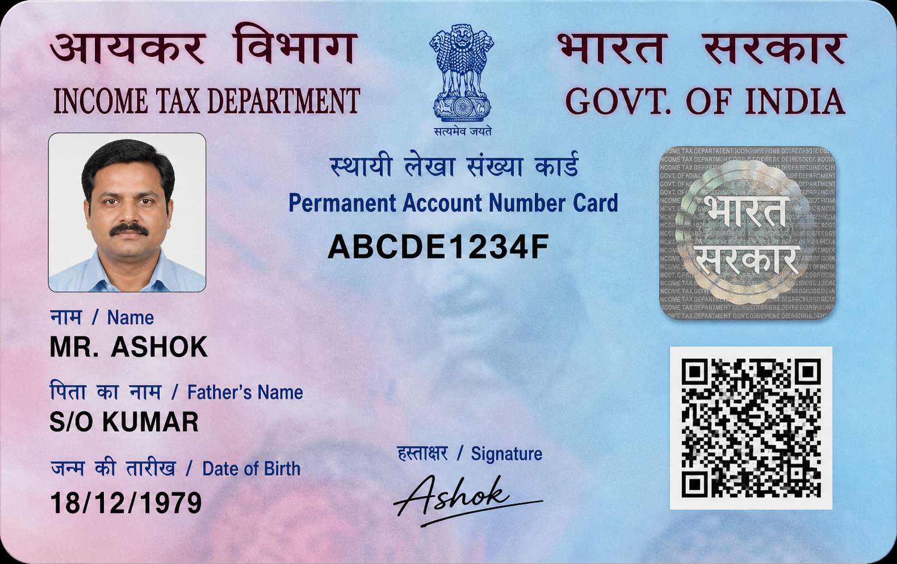

# Supplied assessment test inputs

These are the original files from the supplied assessment folder, included at the user's explicit request for testing in this public repository. They are separate from the synthetic fixtures in `data/synthetic/`. Image filenames have been clarified; their bytes have not been edited or redacted. [MANIFEST.json](MANIFEST.json) maps each filename to its supplied name and SHA-256 checksum.

## Q1 workbook

Upload [Inventory-Records-Sample-Data.xlsx](question-1/Inventory-Records-Sample-Data.xlsx) using the inventory page's workbook upload control. Expected independently verified totals: 46 products, 2,004 stock units and $359,760 inventory value (Hand-In- Stock × Cost Price Per Unit).

## Q3 images

Upload the ten files in `question-3/` using the document review page. Leave automatic classification selected. Turn off **Use ten synthetic text fixtures instead**. For these layouts, expand **Optional local value-line recognition**, enable **Use inspected supplied-layout region templates**, and optionally enable option-box detection. Click **Classify and extract**.

| Document | File |
| --- | --- |
| PAN card | [pan-card.png](question-3/pan-card.png) |
| Aadhaar card | [aadhaar-card.png](question-3/aadhaar-card.png) |
| Driving licence | [driving-licence.png](question-3/driving-licence.png) |
| Passport | [passport.png](question-3/passport.png) |
| FATCA form | [fatca.jpeg](question-3/fatca.jpeg) |
| Suitability declaration | [suitability.jpeg](question-3/suitability.jpeg) |
| Multiple policies consent | [multiple-policies-consent.jpeg](question-3/multiple-policies-consent.jpeg) |
| Moral hazard questionnaire | [moral-hazard.jpeg](question-3/moral-hazard.jpeg) |
| NACH / ECS mandate | [nach-ecs.jpeg](question-3/nach-ecs.jpeg) |
| Benefit illustration declaration | [benefit-illustration.jpeg](question-3/benefit-illustration.jpeg) |

The supplied PAN image is shown below. It is an assessment input, distinct from the artificial text fixture used for the public OCR screenshot.

The existing region option recovered all four PAN fields in the browser test. The full Linux/Tesseract batch represented all 44 required slots, but 24 were blank and all were flagged for review. These files are inputs for testing; including them does not imply extraction is perfectly accurate or that any identity document is authentic. The two additional PDFs in the source folder are outside the ten target image types and are not bundled here.

The app code is unchanged. Use the upload controls to select these inputs; the existing **Use supplied local document files** checkbox still reads `data/private/`, rather than this new repository folder. Keep API keys and any newly generated private outputs out of Git.
