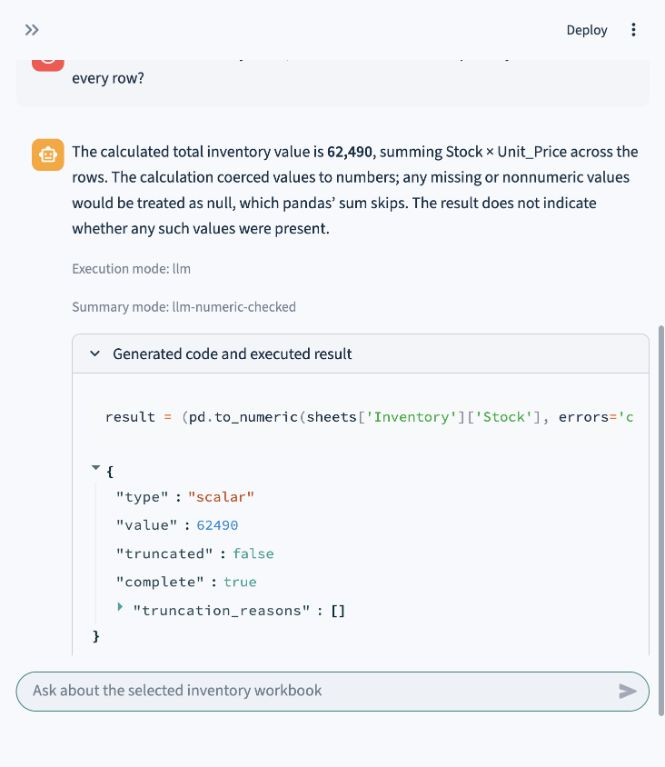
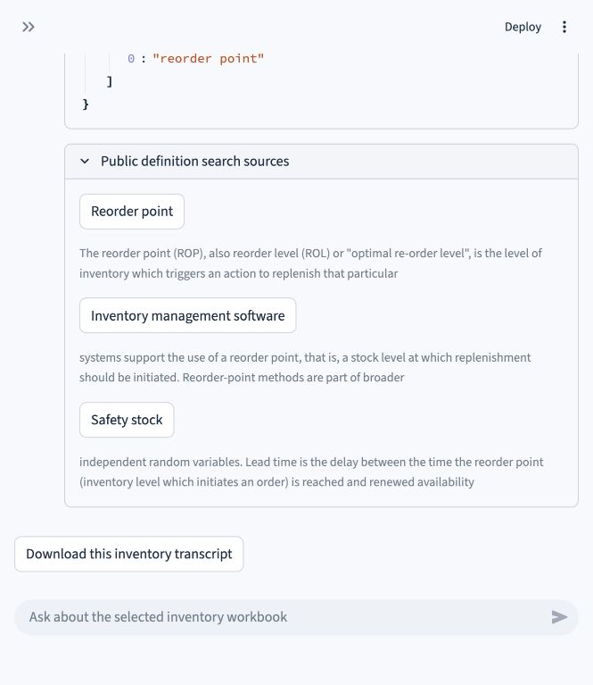
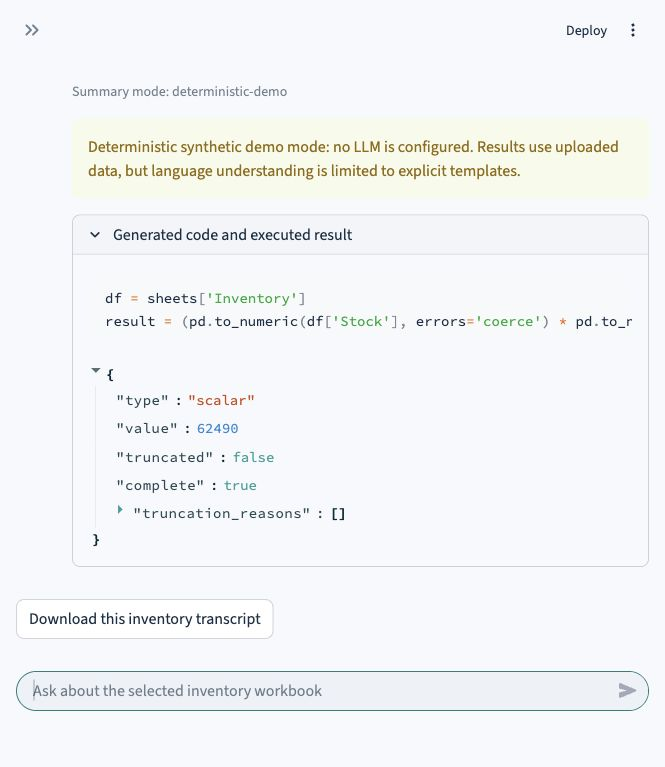
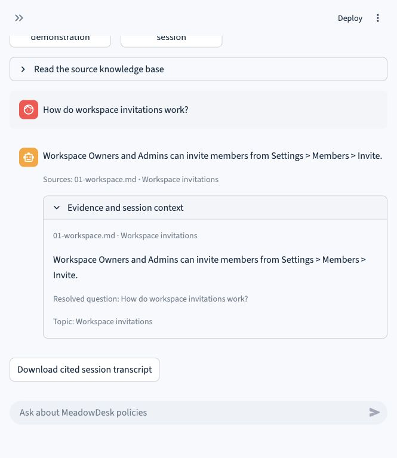
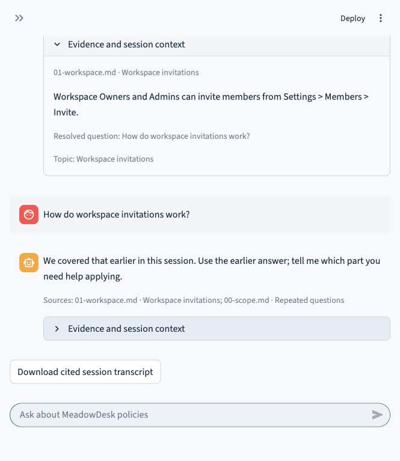
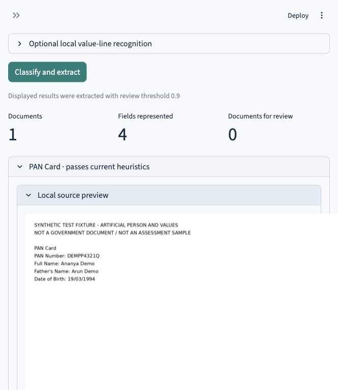
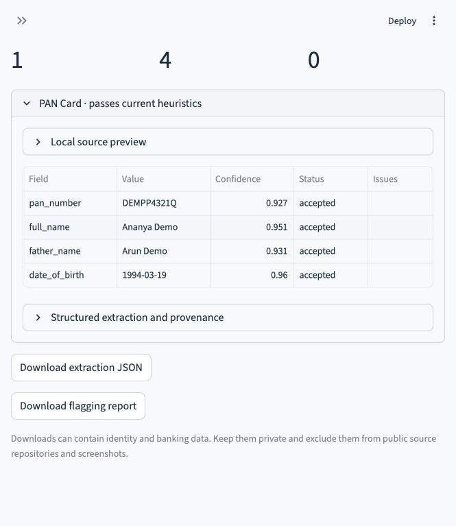
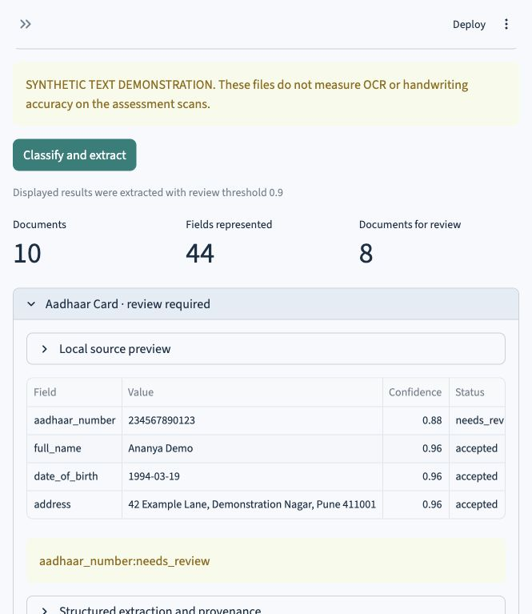

# Version 1 working screenshots

These are actual browser captures. They show the running Version 1 app using synthetic inventory/document fixtures and the fictional MeadowDesk KB. No supplied identity images, private extraction values or credentials are published.

Q1 live-model images were captured during the earlier successful test on the same date. The remaining images were captured for this gallery. The new Q1 offline capture and Q2 local retrieval captures are explicitly labelled; they are not evidence of fresh GPT-6 Luna calls. Q3 synthetic text results do not establish handwriting accuracy.

## Q1: live GPT-6 Luna answer, generated code and executed result

Earlier successful Version 1 browser test, 10 October 2026; synthetic workbook; live GPT-6 Luna.

## Q1: public definition search sources

Earlier successful Version 1 browser test, 10 October 2026; generic reorder-point query.

## Q1: offline planner demonstration

Fresh capture, 10 October 2026; synthetic workbook; offline planner, not an LLM call.

## Q2: answer with a specific KB section and evidence

Fresh capture, 10 October 2026; fictional MeadowDesk KB; local extractive retrieval.

## Q2: remembered question and repetition handling

Fresh capture, 10 October 2026; same local support session.

## Q3: fictional image uploaded for local OCR

Fresh capture, 10 October 2026; artificial PAN fixture, not a government document.

## Q3: OCR field values, quality scores and JSON/report downloads

Fresh capture, 10 October 2026; artificial PAN fixture processed by Tesseract.

## Q3: ten document types, 44 slots and review flags

Fresh capture, 10 October 2026; ten synthetic text fixtures, not handwriting accuracy.

